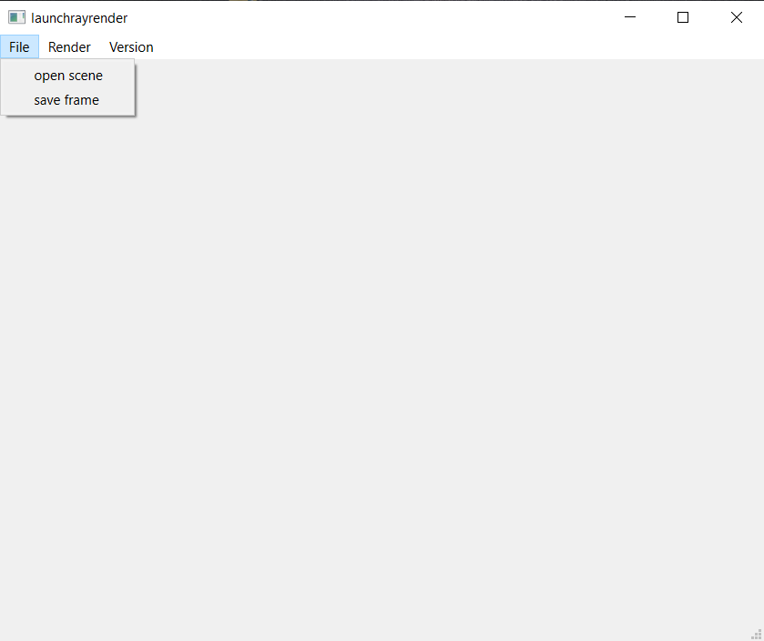
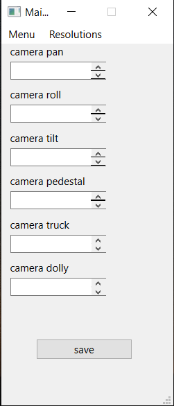
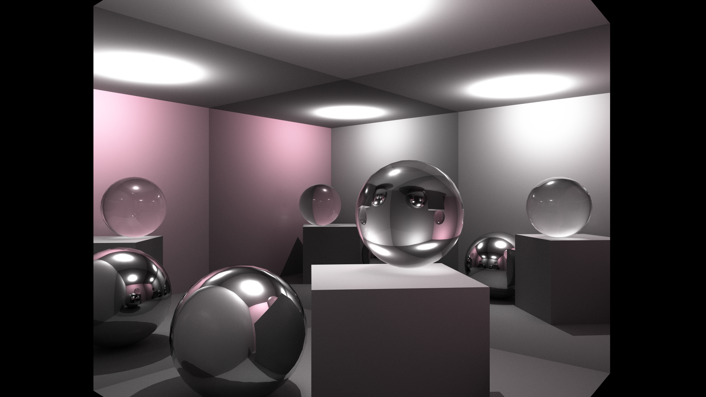

# Qt Ray Tracing Renderer — TU Sofia thesis

C++/Qt desktop ray tracer with scene loading, camera controls, rendering options and acceleration structures.

## Build from source

Install Visual Studio 2022 with C++ tools, a compatible Windows SDK, Qt 6.6.0 MSVC 2019 64-bit and Qt Visual Studio Tools. Open launch-ray render.sln and register the Qt installation in the Qt project settings. The project uses v143 and Qt core/gui/widgets; local SDK and Qt paths may need adjustment.

Build x64 Release. Launch the resulting executable with the required Qt runtime available. Do not add an unverified repository-relative Qt path to the system-wide PATH. Use the Qt developer environment or a per-application deployment with windeployqt.

## Using the renderer

1. Open a .crtscene file from launch-ray render/scenes.
2. Adjust camera, resolution and rendering settings in the menu.
3. Choose a rendering mode and start rendering.
4. Save the frame and compare output on the same scene/settings.

The source includes AABB, bucket rendering and acceleration-tree components. Their relative speed depends on the scene and settings; this README makes no universal performance claim.

## Screenshots

The historical instruciton folder name is preserved so existing links keep working. Generated build artifacts are ignored for future work; existing history is retained.

## Maintenance

Preserve the existing source and sample assets when making changes. Do not commit credentials, personal data or generated build output. This review documents the checked-in project; it does not certify production readiness or a successful build on every platform.
